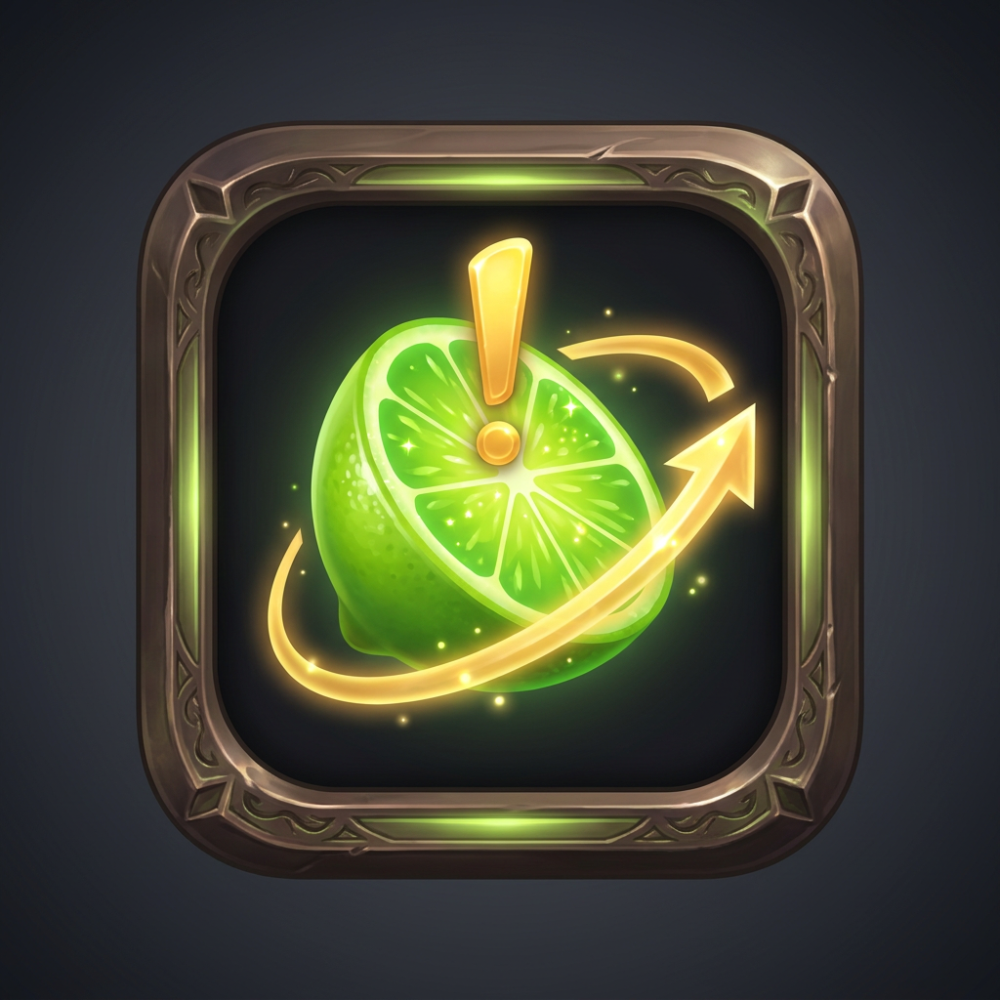

<p align="center">
  
</p>

# Guidelime: CatchUp

[](https://github.com/charlay/Guidelime_CatchUp/releases/latest)
[](https://www.curseforge.com/wow/addons/guidelime-catchup)
[](LICENSE)

**Guidelime: CatchUp** is a standalone companion addon for **[Guidelime](https://github.com/max-ri/guidelime)** and **[Questie](https://github.com/Questie/Questie)**.

When you jump into a mid-level Guidelime leveling guide (for example, switching from dungeons or another zone straight into a level 27–30 guide), that guide often assumes you already picked up quests in previous guides or finished multi-step prerequisite chains in earlier zones. **Guidelime: CatchUp** automatically finds every missing quest, computes a hub-batched, spatially optimized route, and can generate a brand-new merged Guidelime guide so you never run back and forth.

---

## Features

- **Full Gap Detection (via `QuestieDB`):**
  - **Carried-Over Quests:** Finds `[QC]` and `[QT]` steps referenced in your selected guide that have no `[QA]` in that guide (including quests in your log that still need objectives finished before a `[QT]` turn-in).
  - **Recursive Prerequisite Chains:** Walks `preQuestSingle`, `preQuestGroup`, and `availableStartingWith` recursively back to the earliest quest you can actually pick up right now — automatically skipping prerequisites already handled earlier inside the same guide, as well as quests excluded by your race, class, faction, or mutually exclusive chains.
- **Hub-Batched Spatial Route Optimizer:**
  - Breaks catch-up quests into atomic **Accept**, **Do**, and **Turn In** steps using `QuestieDB` starter/objective/finisher coordinates and `HereBeDragons-2.0` continent-wide yard distances.
  - Batches all ready turn-ins (unlocking follow-ups right at the same NPC) and nearby accepts at each quest hub before heading out.
  - Sweeps nearby field objectives in nearest-coordinate order before returning to town, respects a safe 19-quest log cap, and finishes in or near the target guide's starting zone.
- **Non-Destructive Merged Guides:**
  - One click generates a brand-new playable guide (`0-0 CatchUp + <Target Guide>`) combining the optimized catch-up route seamlessly with the full target guide and its `[NX...]` links.
  - **Original guides are never modified or overwritten.**
  - Uncheck **Merge w/ Target** anytime if you prefer a standalone catch-up-only guide.
- **Interactive Guidelime-Themed UI:**
  - **3 Views:** **Route Order** (step-by-step batched actions), **By Zone**, and **By Target Quest** (see exactly which target quest each prerequisite unlocks).
  - **Live Filters:** Toggle **Optional `[O]`**, **Dungeon / Elite**, **Auto-Notify**, and **Merge w/ Target**.
  - **Guide Preview Dropdown:** Inspect missing prerequisites for *any* installed guide before switching to it.
  - **One-Click Navigation:** **Left-Click** any step to set a waypoint (TomTom + native map pin) and open the World Map; **Right-Click** to open your Quest Log (if active) or copy a Wowhead link.
  - **Earlier Guide Lookup:** Hover any quest to see which earlier Guidelime guide originally introduced it.
- **100% Standalone:** Never modifies `Guidelime` or `Questie` files, so addon updates will never overwrite it.

---

## Requirements & Compatibility

**Required Addons:**
- **Guidelime**
- **Questie**

**Supported WoW Clients:**

| Client Flavor | Interface |
| --- | --- |
| WoW: Forever | `16001` |
| Classic Era (Vanilla) | `11508`, `11509` |
| The Burning Crusade Classic | `20506` |
| Wrath of the Lich King Classic | `30404`, `38002` |
| Cataclysm Classic | `40402` |
| Mists of Pandaria Classic | `50504` |

---

## Installation

### Via WowUp (`wowup.io`) — Recommended
1. Open **WowUp**.
2. Go to **Get Addons** → **Install from URL**.
3. Paste:
   ```
   https://github.com/charlay/Guidelime_CatchUp
   ```
4. Click **Import** — WowUp will install and automatically track future releases.

### Manual Installation
1. Download the latest `Guidelime_CatchUp-*.zip` from [GitHub Releases](https://github.com/charlay/Guidelime_CatchUp/releases/latest).
2. Extract the `Guidelime_CatchUp` folder into your WoW `Interface/AddOns/` directory.
3. Restart WoW and make sure **Guidelime: CatchUp** is enabled on the AddOns screen.

---

## Usage

1. Select any leveling guide in **Guidelime**.
2. If you have missing prerequisites or carried-over quests, **Guidelime: CatchUp** displays a notification banner and chat summary.
3. Open the window via **`/catchup`** (or **`/limecatchup`** / **`/glcu`**) or by clicking the **Guidelime: CatchUp minimap icon**.
4. Review your missing quests in **Route Order**, **By Zone**, or **By Target Quest** — or click **Generate Merged Guide** → **Load Guide (Reload UI)** to play the full optimized catch-up + target guide right inside Guidelime with arrows and map pins.
5. When you're done with generated guides, run **`/catchup clear`** and `/reload` to remove them from Guidelime's list.

---

## Slash Commands

| Command | Description |
| --- | --- |
| `/limecatchup`, `/catchup`, `/glcu` | Toggle the CatchUp window |
| `/catchup scan` | Rescan your active Guidelime guide |
| `/catchup generate` | Generate and register the catch-up / merged guide |
| `/catchup clear` | Delete all saved generated guides (then `/reload`) |
| `/catchup minimap` | Show or hide the minimap button |
| `/catchup debug` | Toggle debug logging |

---

## FAQ

**Does this modify Guidelime or my guide packs?**  
No. `Guidelime_CatchUp` is completely standalone. It hooks `Guidelime.registerGuide` at load time and registers generated guides as separate entries (`0-0 CatchUp + ...`), leaving all original guides untouched.

**Why does "Load Guide" reload the UI?**  
Because `Guidelime` keeps its internal guide loader private unless debug mode is enabled. Clicking **Generate Merged Guide** immediately registers the guide in Guidelime's Available Guides list (so you can select it there without reloading if you prefer), while **Load Guide (Reload UI)** switches directly to it in one click.

**What if a guide pack loads before `Guidelime_CatchUp`?**  
WoW loads addons alphabetically after dependencies. `Guidelime_CatchUp` loads before almost all standard packs (`TUGs`, `Sage`, `MarkyMark`, `Shiku`, `Flymolo`, `Ettern`, etc.) and also imports `GuidelimeData.customGuides`.

---

## Credits & License

- Built for [Guidelime](https://github.com/max-ri/guidelime) and [Questie](https://github.com/Questie/Questie), using `HereBeDragons-2.0`, `LibDataBroker-1.1`, and `LibDBIcon-1.0`.
- Released under the [MIT License](LICENSE).
